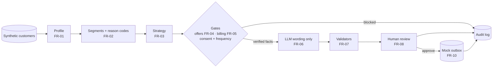

<div align="center">

# Customer Loyalty and Engagement Assistant

**Explainable customer segmentation and grounded, human-approved email drafting**

*HCLTech Future Ready AI Engineer Hackathon*

[](https://github.com/RuhelaDhruv745/practice-project/actions/workflows/ci.yml)


</div>

---

## Overview

The assistant helps a retention team reach the right customers with the right message,
safely. It:

1. **Profiles** synthetic customers from permitted data only.
2. **Segments** them with deterministic, interpretable rules, with reason codes and a
   confidence score.
3. **Selects** a policy-approved strategy, offer and billing-reminder stage.
4. **Drafts** an email subject and body with an LLM, using verified facts only.
5. **Validates** every draft for unsupported claims, ineligible offers, missing
   consent, duplicate outreach, privacy leaks and prohibited language.
6. **Routes** the draft to a human reviewer, who can edit, approve or reject it.
7. **Delivers** approved drafts to a mock outbox only, and records every step in an
   audit log.

> **Project status: architecture baseline.** Contracts, policy configuration with a
> validated loader, documentation and module scaffolding are in place. The API,
> generator, validators and user interfaces are being built by the five team members
> on their feature branches.

## Design guarantees

| Principle | What it means in practice |
|---|---|
| **Code decides facts** | Segment, eligibility, billing stage, amounts, dates, consent and contact permission come from the deterministic `policy_engine`. |
| **The LLM only words** | The model receives `VerifiedFacts` and returns `{subject, body}` as JSON. It never chooses offers or stages. |
| **Every draft is validated** | Generated and human-edited drafts both pass `PolicyEngine.validate`. A blocking finding blocks the draft. |
| **A person approves** | Approval re-validates the draft. Nothing is sent automatically, in bulk, or to a real inbox. |
| **Privacy and fairness** | No protected characteristics or proxies; no email addresses in prompts, logs or audit records. |
| **Policy as configuration** | Thresholds, segments, offers, tones and reminder stages live in `data/policies/*.yaml`. |

## Architecture



| Layer | Technology |
|---|---|
| Reviewer UI (hackathon deliverable) | Streamlit |
| Dashboard | React, TypeScript, Vite, Tailwind CSS, React Query |
| API and orchestration | FastAPI, Pydantic, SQLAlchemy |
| Database | SQLite (PostgreSQL-compatible schema) |
| LLM | Anthropic Claude by default, Groq fallback, `mock` provider when no key is set |
| Quality | pytest, ruff, Vitest, Playwright, GitHub Actions |
| Deployment (planned) | Docker Compose locally, Azure Container Apps |

Full detail: [`docs/ARCHITECTURE.md`](docs/ARCHITECTURE.md) and
[`docs/TECH_STACK.md`](docs/TECH_STACK.md).

## Repository layout

```text
contracts/        Canonical Pydantic models, enums and module Protocols (frozen v1.0)
policy_engine/    Deterministic classification, eligibility, billing, consent, validators
ai_engine/        LLM provider adapters, prompts, structured output, evaluation
backend/          FastAPI API, persistence, orchestration, approval gating, audit, outbox
reviewer_ui/      Streamlit reviewer application
frontend/         React + TypeScript dashboard
data/             policies/ and campaigns/ (YAML), synthetic/ and fixtures/ (test data)
tests/            Cross-module integration, end-to-end and evaluation tests
infrastructure/   Docker, Azure and monitoring configuration
docs/             Requirements, architecture, contracts, member specs and guides
```

## Team and branches

Each member owns a disjoint set of paths and works on a dedicated branch. Changes reach
`main` only through a pull request with passing CI and architect review.

| Member | Role | Branch | Owns |
|---|---|---|---|
| Lead | Architect and integration | `main` (via PR) | `contracts/`, `docs/`, `.claude/`, root config |
| 1 | Backend | `feature/backend` | `backend/` |
| 2 | AI / LLM | `feature/ai-engine` | `ai_engine/` |
| 3 | Policy / decision | `feature/policy-engine` | `policy_engine/`, `data/policies/`, `data/campaigns/` |
| 4 | Frontend | `feature/frontend` | `reviewer_ui/`, `frontend/` |
| 5 | DevOps / QA / data | `feature/devops-testing` | `data/synthetic/`, `data/fixtures/`, `tests/`, `infrastructure/`, `scripts/`, CI |

Merge order: backend, policy, AI, frontend, DevOps/QA, then acceptance. See
[`docs/TEAM_ASSIGNMENTS.md`](docs/TEAM_ASSIGNMENTS.md) and
[`docs/INTEGRATION_GUIDE.md`](docs/INTEGRATION_GUIDE.md).

## Getting started

### Prerequisites

Python 3.13, Git, Node.js 22 (frontend only) and, optionally, Docker Desktop. An LLM
key is optional: without one, `LLM_PROVIDER=mock` keeps the project fully runnable.

### Setup

```powershell
git clone https://github.com/RuhelaDhruv745/practice-project.git
cd practice-project
git switch feature/<your-branch>   # backend | ai-engine | policy-engine | frontend | devops-testing

py -3.13 -m venv .venv
.venv\Scripts\Activate.ps1
python -m pip install -r requirements.txt -r requirements-dev.txt
copy .env.example .env             # add your own keys; never commit .env
```

### Verify

```powershell
python -m pytest          # all tests
python -m ruff check .    # lint
```

### Start your Claude Code session

On the lead's machine each branch already has a worktree (`..\team-backend`,
`..\team-ai`, `..\team-policy`, `..\team-frontend`, `..\team-devops`); create a
`.venv` inside it, since virtual environments are not shared. Then:

```powershell
claude
```

and paste the **Startup prompt** from your spec in [`docs/members/`](docs/members/).
Worktrees are local to one machine; on your own laptop, clone and switch branch as above.

Run commands for the API, UIs and Docker are documented in
[`docs/DEVELOPMENT_GUIDE.md`](docs/DEVELOPMENT_GUIDE.md) and
[`docs/DEPLOYMENT.md`](docs/DEPLOYMENT.md) as those entry points land.

## Documentation

| Topic | Documents |
|---|---|
| Brief and requirements | [`problem-statement.md`](docs/problem-statement.md), [`REQUIREMENTS.md`](docs/REQUIREMENTS.md) |
| Design | [`ARCHITECTURE.md`](docs/ARCHITECTURE.md), [`TECH_STACK.md`](docs/TECH_STACK.md), [`DATABASE_DESIGN.md`](docs/DATABASE_DESIGN.md) |
| Contracts | [`API_CONTRACTS.md`](docs/API_CONTRACTS.md), [`DATA_DICTIONARY.md`](docs/DATA_DICTIONARY.md) |
| Team | [`TEAM_ASSIGNMENTS.md`](docs/TEAM_ASSIGNMENTS.md), [`members/`](docs/members/), [`INTEGRATION_GUIDE.md`](docs/INTEGRATION_GUIDE.md), [`DEVELOPMENT_GUIDE.md`](docs/DEVELOPMENT_GUIDE.md) |
| Quality and safety | [`TESTING_STRATEGY.md`](docs/TESTING_STRATEGY.md), [`SECURITY.md`](docs/SECURITY.md), [`EVALUATION_REPORT.md`](docs/EVALUATION_REPORT.md) |
| Delivery | [`DEPLOYMENT.md`](docs/DEPLOYMENT.md), [`DEMO_SCRIPT.md`](docs/DEMO_SCRIPT.md), [`PRE_HACKATHON_READINESS.md`](docs/PRE_HACKATHON_READINESS.md) |

## Contributing

- Read [`CLAUDE.md`](CLAUDE.md) and your member spec before writing code.
- Edit only the paths you own; propose contract or ownership changes through a
  **Contract or ownership change** issue.
- Use Conventional Commits with a module scope, e.g. `feat(policy): add reminder stage selection`.
- Run `python -m pytest` and `python -m ruff check .` before every push.
- Never commit `.env`, keys, `outputs/` or real data; never force-push or push to `main`.

## Scope and limitations

- **Synthetic data only** (about 15 customers). No real customer, CRM or billing data.
- Thresholds, offers and reminder stages are editable assumptions in `data/policies/`,
  not learned values. Segmentation is rule-based, not machine-learned.
- Delivery is a mock outbox. There is no real email sending, bulk messaging or
  financial action.
- Nothing is deployed to Azure without explicit team approval.
