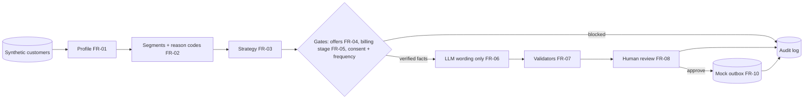

# Customer Loyalty and Engagement Assistant

HCLTech Future Ready AI Engineer Hackathon project. The assistant segments synthetic
customers with deterministic, explainable rules, chooses an approved communication
strategy, asks an LLM to word an email from verified facts only, validates the draft,
and puts it in front of a human reviewer. Nothing is sent without approval, and
"sending" writes to a mock outbox.

> **Status: architecture baseline.** Contracts, policy configuration and its loader,
> documentation and scaffolding exist. The API, generator, validators and UIs are being
> built by the five team members on their feature branches.

## How it works



The model never decides a segment, offer, amount, date or reminder stage.

## Repository layout

| Path | Contents | Owner |
|---|---|---|
| `contracts/` | Canonical Pydantic models, enums and module interfaces | Architect |
| `policy_engine/` | Classification, eligibility, billing stages, consent, validators | Member 3 |
| `ai_engine/` | LLM provider adapter, prompts, structured output | Member 2 |
| `backend/` | FastAPI API, persistence, orchestration, audit, mock delivery | Member 1 |
| `reviewer_ui/`, `frontend/` | Streamlit reviewer app, React dashboard | Member 4 |
| `data/` | `policies/` YAML (Member 3), `synthetic/` and `fixtures/` (Member 5) | |
| `tests/`, `infrastructure/`, `scripts/`, `.github/workflows/` | Integration and e2e tests, Docker, Azure, CI | Member 5 |
| `docs/` | Requirements, architecture, contracts, member specs, guides | Architect |

## Quick start

```powershell
py -3.13 -m venv .venv
.venv\Scripts\Activate.ps1
python -m pip install -r requirements.txt -r requirements-dev.txt
copy .env.example .env   # then fill in your own key; never commit .env
python -m pytest
```

Run commands for the API and UIs are in `docs/DEVELOPMENT_GUIDE.md`, and Docker and
Azure steps are in `docs/DEPLOYMENT.md`, once those entry points exist.

## Documentation

- Brief: `docs/problem-statement.md`. Requirements: `docs/REQUIREMENTS.md`.
- Architecture: `docs/ARCHITECTURE.md`, `docs/TECH_STACK.md`, `docs/DATABASE_DESIGN.md`.
- Contracts: `docs/API_CONTRACTS.md`, `docs/DATA_DICTIONARY.md`.
- Team: `docs/TEAM_ASSIGNMENTS.md`, `docs/members/`, `docs/INTEGRATION_GUIDE.md`.
- Quality: `docs/TESTING_STRATEGY.md`, `docs/SECURITY.md`, `docs/EVALUATION_REPORT.md`.
- Readiness: `docs/PRE_HACKATHON_READINESS.md`.

## Assumptions and limits

Synthetic data only (about 15 customers). Thresholds, offers and reminder stages are
editable assumptions in `data/policies/`, not learned values. No real email, CRM,
billing integration, or machine-learned segmentation.
