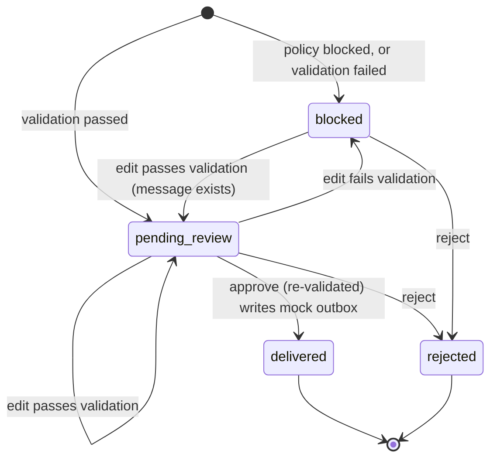

# API Contracts

Status: **frozen at baseline** (version `1.0`). Changes need an approved
"Contract or ownership change" issue and a PR that updates this file,
`docs/DATA_DICTIONARY.md` and `contracts/` together.

- Base URL (local): `http://localhost:8000`. All paths start with `/api`.
- JSON only. Dates are ISO `YYYY-MM-DD`, timestamps ISO 8601 UTC, money is a decimal
  **string** (`"2000.00"`) to avoid float rounding.
- Domain schemas are the Pydantic models in `contracts/models.py`; request and response
  bodies (`CustomerRequest`, `ValidateRequest`, `EditReviewRequest`, `ApproveRequest`,
  `RejectRequest`, `ApproveResponse`, `CustomerSummary`, `Page[T]`, `HealthResponse`) are
  in `contracts/api.py`. Member 1 must use them, not redefine them. Field-level
  definitions are in `docs/DATA_DICTIONARY.md`. FastAPI serves the live OpenAPI schema at
  `/docs` and `/openapi.json`; the React app generates its TypeScript types from it.
- No authentication in the hackathon build. `reviewer_id` is a pseudonymous label such
  as `reviewer-1` (pattern `^[a-z0-9-]{3,40}$`). This is a documented limitation.
- Provider: Member 1. Consumers: Member 4 (both UIs), Member 5 (integration and e2e tests).

## Module interfaces (in-process, not HTTP)

Defined as `typing.Protocol` in `contracts/interfaces.py`. The backend depends on these,
never on a concrete class, and injects implementations at startup.

| Call | Provider | Returns | Notes |
|---|---|---|---|
| `PolicyEngine.classify(profile)` | Member 3 | `ClassificationResult` | Deterministic |
| `PolicyEngine.decide(profile)` | Member 3 | `PolicyDecision` | `BLOCKED` + reasons, or `DRAFT_ALLOWED` + `VerifiedFacts` |
| `PolicyEngine.validate(draft, decision)` | Member 3 | `ValidationResult` | Used for generated and edited drafts |
| `DraftGenerator.generate(facts)` | Member 2 | `GeneratedMessage` | Raises `GenerationError`; never sees the profile |

## Error format

Every non-2xx response has this body (`ErrorResponse`):

```json
{"error": {"code": "review_not_approvable", "message": "Validation failed; draft cannot be approved.", "details": {"status": "pending_review", "blocking_findings": ["blocked_term"]}}}
```

| HTTP | `error.code` | When |
|---|---|---|
| 400 | `bad_request` | Malformed JSON body |
| 404 | `customer_not_found`, `review_not_found` | Unknown ID |
| 409 | `review_not_editable` | Edit when status is `rejected` or `delivered`, or the item is `blocked` by **policy** (`message` is `null`). Editable: `pending_review`, and `blocked` with a message (validation failure). |
| 409 | `review_not_approvable` | Approve when status is not `pending_review`, or the latest validation did not pass, or the decision is `blocked` |
| 409 | `review_already_decided` | Approve or reject an item that is already `approved`, `rejected` or `delivered` |
| 422 | `validation_error` | Request body fails schema validation (`details.errors` lists fields) |
| 502 | `generation_failed` | LLM provider failed or returned unusable output after one retry |
| 500 | `internal_error` | Anything else. Never includes stack traces or secrets. |

A policy refusal (no consent, contacted recently, contradictory data) is **not** an error:
it is a normal `201` result with `status: "blocked"`.

## Endpoints

### `GET /api/health`
`200` → `{"status": "ok", "version": "0.1.0", "policy_versions": {"policy": "1.0", ...}, "llm_provider": "anthropic", "llm_mode": "live" | "mock"}`.
Never returns keys or secrets. `llm_mode` is `mock` when no API key is configured.

### `GET /api/customers`
Query: `segment` (optional `SegmentName`), `limit` (1–100, default 50), `offset` (≥ 0).
`200` → `{"items": [CustomerSummary], "total": int}` where `CustomerSummary` is
`{customer_id, first_name, plan, bill_status, consent_marketing, primary_segment | null}`.

### `GET /api/customers/{customer_id}`
`200` → `CustomerProfile`. `404 customer_not_found`.
The response contains permitted fields only (FR-01); there is no email field to return.

### `POST /api/classification/evaluate`
Body: `{"customer_id": "CUST-001"}`.
`200` → `PolicyDecision` (contains the `ClassificationResult`, strategy, offer checks and,
if allowed, the `VerifiedFacts`). Does not call the LLM and does not create a review item.
Writes audit events `classified` and `policy_decided`. `404 customer_not_found`.

### `POST /api/messages/generate`
Body: `{"customer_id": "CUST-001"}`.
Runs the full pipeline: decide → (if allowed) generate → validate → create review item.
`201` → `ReviewItem`:

| Outcome | `status` | `message` | `validation` |
|---|---|---|---|
| Policy blocked (consent, frequency, contradictory or missing data) | `blocked` | `null` | `null` |
| Draft generated, validation failed | `blocked` | present | `passed: false` |
| Draft generated, validation passed | `pending_review` | present | `passed: true` |

`404 customer_not_found`. `502 generation_failed` (audit `generation_failed`, no item).
Audit: `policy_decided`, then `outreach_blocked` or `draft_generated` + `draft_validated`.

### `POST /api/messages/validate`
Dry-run validation for any draft; changes nothing.
Body: `{"customer_id": "CUST-001", "draft": {"subject": "...", "body": "..."}}`.
`200` → `ValidationResult`. If the policy decision is blocked, the result has
`passed: false` with a `consent_gap` or `duplicate_outreach` finding as applicable.

### `GET /api/reviews/pending`
Query: `status` (optional, default `pending_review`; may also be `blocked`), `limit`, `offset`.
`200` → `{"items": [ReviewItem], "total": int}`. Blocked items are listed so reviewers
can see refusals and their reasons.

### `PATCH /api/reviews/{review_id}`
Reviewer edit. Body: `{"reviewer_id": "reviewer-1", "draft": {"subject": "...", "body": "..."}, "comment": "optional"}`.
The backend stores the edit as a new `GeneratedMessage` with `source: "reviewer_edit"`,
re-runs `PolicyEngine.validate` on it, increments `revision` and sets `status` to
`pending_review` (passed) or `blocked` (failed). Every reviewer action is appended to
`ReviewItem.decisions`; the `draft_validated` audit event records `message_id` and
`revision` in `details`.
`200` → `ReviewItem`. `404`, `409 review_not_editable`, `422`.
Audit: `review_edited` + `draft_validated`.
An item blocked by **policy** (no message) cannot be edited into existence.

### `POST /api/reviews/{review_id}/approve`
Body: `{"reviewer_id": "reviewer-1", "comment": "optional", "rubric": ReviewRubric | null}`.
Allowed only when `status == pending_review` **and** the latest `validation.passed`
**and** the decision is `draft_allowed`. The backend re-validates immediately before
delivery (defence against stale state). On success it writes an `OutboxRecord` to the
mock outbox and sets `status` to `delivered`.
`200` → `{"review": ReviewItem, "outbox": OutboxRecord}`.
`409 review_not_approvable` (audit `delivery_refused`), `409 review_already_decided`, `404`.
Audit: `review_approved`, `message_delivered`.

### `POST /api/reviews/{review_id}/reject`
Body (`RejectRequest`): `{"reviewer_id": "reviewer-1", "comment": "required reason, 1-1000 chars", "rubric": ReviewRubric | null}`.
Allowed for `pending_review` and `blocked`. `200` → `ReviewItem` with `status: rejected`.
`409 review_already_decided`, `404`, `422`. Audit: `review_rejected`.

### `GET /api/audit`
Query: `customer_id`, `review_id`, `event_type` (all optional), `limit` (1–500, default
100), `offset`. `200` → `{"items": [AuditEvent], "total": int}`, newest first.
Audit events never contain email addresses (enforced by the `AuditEvent` model).

## State machine (review item)



`approved` exists in `MessageStatus` for audit readability; with mock delivery the API
moves straight from approval to `delivered` in one transaction.
