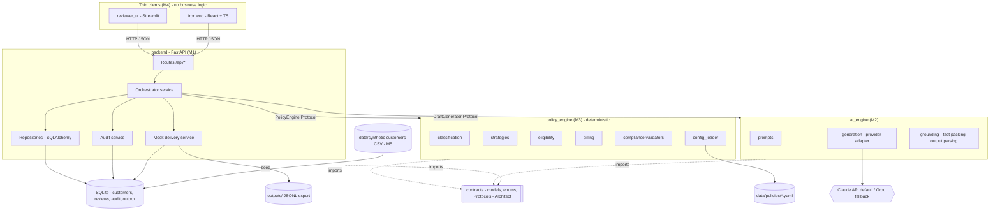
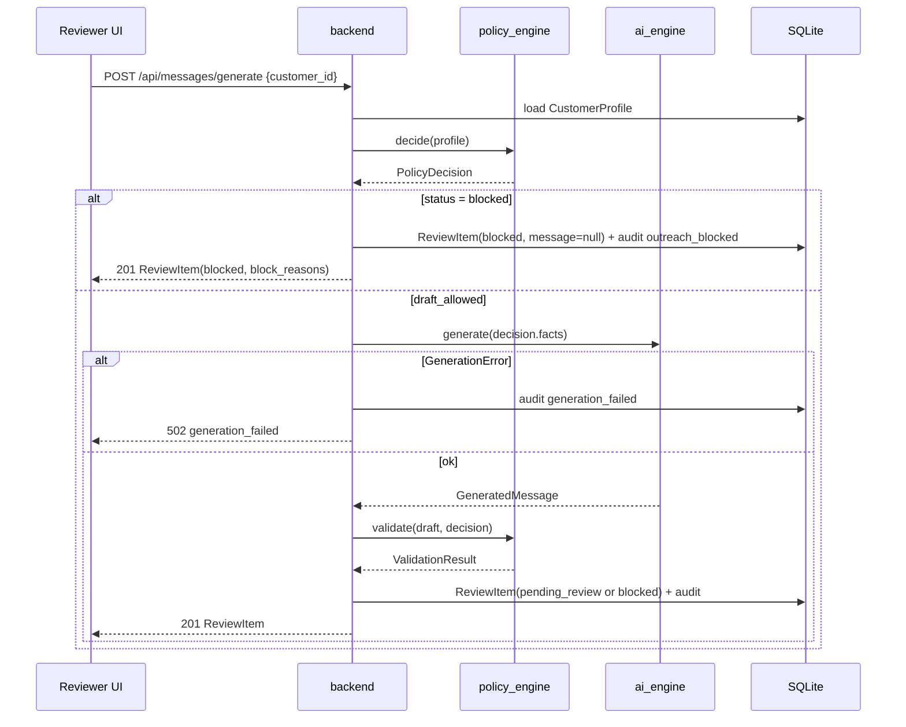
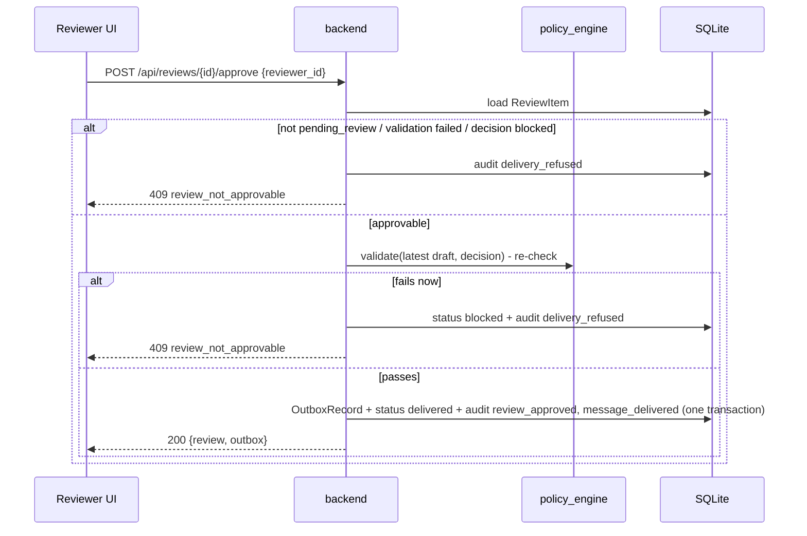

# Architecture

Core idea: **code decides facts, the LLM only words them, a validator checks the words,
a human approves, and delivery is a mock.** Canonical models: `contracts/models.py`.
HTTP contract: `docs/API_CONTRACTS.md`. Ownership: `docs/TEAM_ASSIGNMENTS.md`.

## 1. Components

| Component | Responsibility | Must never |
|---|---|---|
| `reviewer_ui`, `frontend` | Display evidence, draft, findings; send reviewer actions | Compute segments, eligibility or approval state |
| `backend` | HTTP API, orchestration, persistence, audit, mock delivery, approval gating | Decide facts itself or call an LLM directly |
| `policy_engine` | Classify, choose strategy, check offers, stage, consent, frequency; build `VerifiedFacts`; validate drafts | Call an LLM |
| `ai_engine` | Turn `VerifiedFacts` into `DraftContent` via the configured provider | See the profile, choose offers or stages, approve anything |
| `contracts` | Canonical schemas and module `Protocol`s | Contain business logic |

## 2. Data flow (one customer)

| Step | Producer | Artifact | FR |
|---|---|---|---|
| 1 | backend repository | `CustomerProfile` (permitted fields only) | FR-01 |
| 2 | `PolicyEngine.classify` | `ClassificationResult` (segments, reasons, confidence) | FR-02 |
| 3 | `PolicyEngine.decide` | `PolicyDecision`: strategy, `OfferCheck`s, reminder, consent, frequency → `BLOCKED` + reasons or `DRAFT_ALLOWED` + `VerifiedFacts` | FR-03/04/05 |
| 4 | `DraftGenerator.generate` | `GeneratedMessage` with `DraftContent` | FR-06 |
| 5 | `PolicyEngine.validate` | `ValidationResult` | FR-07 |
| 6 | backend | `ReviewItem` (`blocked` or `pending_review`) | FR-08 |
| 7 | reviewer | edit (re-validated), approve or reject → `ReviewDecision` | FR-08 |
| 8 | backend | `OutboxRecord` + `AuditEvent`s | FR-09/10 |

## 3. Generate and approve sequences

## 4. Deterministic policy boundary

- `PolicyEngine` is the only producer of `VerifiedFacts`. The generator receives
  `decision.facts` and nothing else: no profile, no consent flag, no other offers.
- Amounts, dates, offer IDs and values in `VerifiedFacts` are copied from data and
  config, never computed by the LLM.
- Policy is loaded once at startup by `policy_engine.config_loader.load_policy`;
  versions of every file are recorded on each decision (`policy_versions`).
- `as_of_date` comes from config, so results are reproducible.

## 5. AI generation workflow (M2)

| Stage | Behaviour |
|---|---|
| Input | `VerifiedFacts` only. `first_name` and plan text are wrapped as quoted data, never as instructions. |
| Prompt | Versioned template in `ai_engine/prompts/` (`prompt_version` recorded). Tone guidance from facts. |
| Provider | Adapter chosen by `LLM_PROVIDER`: `anthropic` (default) or `groq` (OpenAI-compatible). `mock` when no key is set or in tests. |
| Output | JSON with exactly `subject` and `body`, parsed into `DraftContent` (extra fields rejected). |
| Errors | Rate limit/timeout: retry with backoff. Malformed JSON or schema error: retry once. Still failing: raise `GenerationError`. |
| Result | `GeneratedMessage` with provider, model, `prompt_version`, timestamp. Validation is done by M3, not by the generator. |

## 6. Human approval flow

The review state machine is defined once, in `docs/API_CONTRACTS.md` → "State machine".
Rules: only `pending_review` with a passing latest validation and a `draft_allowed`
decision can be approved; every edit is re-validated; approval re-validates before
delivery; policy-blocked items have no message and cannot be edited into one.

## 7. Audit architecture

- Append-only `audit_events` table; the backend never updates or deletes rows.
- Each event (`AuditEvent`) records type, actor, IDs, `policy_versions`,
  `prompt_version`, `model` and evidence `details`.
- The `AuditEvent` model rejects any email address in `details`. Customers are
  referenced by `customer_id` only. Draft text is stored with the review item, not
  copied into every event.
- Reconstruction: filter `GET /api/audit?customer_id=…` to replay decided → generated →
  validated → reviewed → delivered.

## 8. Delivery architecture

- Mock only. Approval writes an `OutboxRecord` row (`channel: email`) and appends the
  same record as one JSON line to `outputs/outbox.jsonl` (git-ignored).
- No SMTP client or email SDK is a dependency. There is no recipient address to send to.
- No bulk endpoint: one approval delivers one message.

## 9. Security architecture

| Concern | Control |
|---|---|
| Secrets | `.env` only (git-ignored); names in `.env.example`; Azure secrets in Key Vault / Container Apps secrets; never logged or returned by `/api/health` |
| Personal data | No email field; permitted-field allowlist; audit email guard |
| Prompt injection | Customer text quoted as data; LLM output limited to subject/body; validators check every fact |
| Fairness | No protected characteristics or proxies in data, config or rules |
| Approval bypass | Gating only in backend; UIs cannot set status; approve re-validates |
| Transport | HTTPS at the Azure ingress; CORS restricted to the UI origins |

## 10. Failure handling

| Failure | Behaviour |
|---|---|
| LLM outage or rate limit | Retry with backoff; then `502 generation_failed`, audit `generation_failed`, no review item. Demo can switch to `LLM_PROVIDER=mock`. |
| No API key configured | Mock generator; `/api/health` reports `llm_mode: mock` |
| Malformed LLM output | One retry; then `GenerationError` → `502` |
| Draft fails validation | `ReviewItem` with `status: blocked` and findings; cannot be approved |
| Invalid policy config | `ConfigError` at startup; the backend refuses to start |
| Contradictory or missing customer data | Policy decision `blocked` with `contradictory_billing_data` / `missing_evidence` |
| Database error | Transaction rolled back; `500 internal_error`; no partial delivery (outbox and status change share one transaction) |
| Unknown IDs | `404` with `ErrorResponse` |
