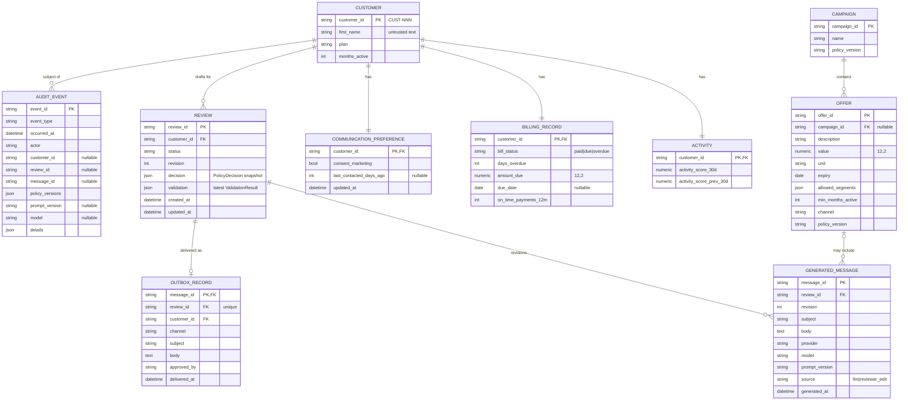

# Database Design

Owner: **Member 1** (`backend/app/models/`, `backend/app/database/`,
`backend/app/repositories/`). Canonical API shapes stay in `contracts/`; ORM models are
an internal storage detail and are mapped to/from contract models in the repository layer.

## Principles

| Rule | How |
|---|---|
| SQLite now, PostgreSQL later | SQLAlchemy 2.x ORM; portable types only (`String`, `Integer`, `Boolean`, `Numeric(12,2)`, `Date`, `DateTime(timezone=True)`, `JSON`). No SQLite-only pragmas or types in models. |
| Money is exact | `Numeric(12, 2)` ↔ `Decimal`; never `Float` |
| Timestamps | `DateTime(timezone=True)`, stored in UTC |
| Location | `DATABASE_URL`, default `sqlite:///outputs/app.db` (`outputs/` is git-ignored) |
| No email anywhere | No table has an email (or address, age, gender, …) column |
| Policy is config | Offers/campaigns live in `data/policies/*.yaml`; the DB stores a **snapshot** with the policy version so audits can be reconstructed |
| Audit is append-only | Repository exposes `append()` and reads only; no UPDATE/DELETE |
| Seeding | `scripts/` / backend startup command loads `data/synthetic/customers.csv` (validated through `CustomerProfile`) into the tables below; idempotent |

## Entity-relationship diagram

## Tables

| Table | Purpose | Key validation (DB + repository) | Indexes |
|---|---|---|---|
| `customer` | Identity and plan | PK pattern checked via `CustomerProfile` on seed | PK |
| `activity` | Recent vs previous activity | `CHECK 0 <= score <= 100` | PK |
| `billing_record` | Current bill facts | `CHECK days_overdue >= 0`, `CHECK amount_due >= 0`, `CHECK bill_status IN (...)`, `CHECK on_time_payments_12m BETWEEN 0 AND 12`. Contradictions (paid + overdue days) are **stored as-is** so policy can block them | PK, `bill_status` |
| `communication_preference` | Consent and contact history | `consent_marketing NOT NULL` | PK |
| `campaign` | Groups offers; snapshot of YAML | | PK |
| `offer` | Snapshot of `offers.yaml` with `policy_version` | `CHECK value > 0`; reloaded from YAML at startup | PK, `campaign_id` |
| `review` | One draft workflow per customer request | `CHECK revision >= 1`; status transitions enforced in service layer only | `status`, `customer_id`, `created_at` |
| `generated_message` | Every draft revision (LLM or reviewer edit) | Unique `(review_id, revision)` | `review_id` |
| `outbox_record` | Mock deliveries | Unique `review_id` (one delivery per review); written in the same transaction as status → `delivered` | `customer_id` |
| `audit_event` | Append-only decision history | `details` validated by `AuditEvent` (no emails) before insert | `occurred_at`, `customer_id`, `review_id`, `event_type` |

## Assembling `CustomerProfile` (FR-01)

`CustomerRepository.get_profile(customer_id) -> CustomerProfile`:

1. One query joining `customer` + `activity` + `billing_record` + `communication_preference`
   on `customer_id`.
2. Map columns 1:1 onto the `CustomerProfile` fields (names are identical to the CSV and
   the contract). Select **only** those columns; nothing else leaves the repository.
3. Construct `CustomerProfile(...)`; a validation error is a server error (bad seed data),
   logged without field values.
4. Append audit event `profile_assembled` with `details={"fields": [...names...]}` (names only).

The backend passes this profile to `PolicyEngine.decide`; the LLM never sees it.

## Write paths

| Action | Tables written (one transaction) |
|---|---|
| Generate | `review`, `generated_message` (rev 1, if allowed), `audit_event` |
| Edit | `generated_message` (rev n+1, `source=reviewer_edit`), `review` (revision, validation, status), `audit_event` |
| Approve | `review` (status `delivered`), `outbox_record`, `audit_event` ×2; also appends a JSONL line to `outputs/outbox.jsonl` |
| Reject | `review` (status `rejected`), `audit_event` |

Migrations: `Base.metadata.create_all` for the hackathon; Alembic is the documented path
when moving to PostgreSQL.
