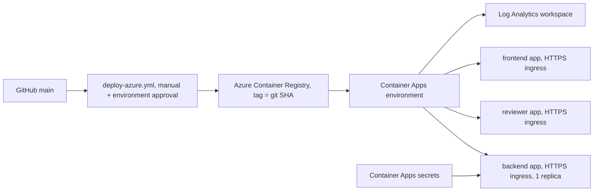

# Deployment: Docker and Azure

Owner: **Member 5**. Status: **local containers implemented; Azure plan written, never
deployed.** No Azure resource exists and nothing may be created or deployed without
explicit team approval.

## 1. Local containers

Prerequisite: Docker Desktop (Compose v2.24 or later) with the engine running
(`docker info` must show a `Server:` section without errors).

```sh
docker compose up --build                       # backend + reviewer_ui
docker compose --profile frontend up --build    # also the React frontend (needs frontend/)
sh scripts/docker_smoke.sh                      # health, seeded customers, Streamlit health
docker compose down                             # stop; keeps the app-data volume
docker compose down -v                          # stop AND delete the SQLite volume (reset)
```

| Service | Dockerfile | Container port | Host URL | Health check |
|---|---|---|---|---|
| `backend` | `infrastructure/docker/backend.Dockerfile` | 8000 | http://localhost:8000 (API docs at `/docs`) | `GET /api/health` |
| `reviewer_ui` | `infrastructure/docker/reviewer_ui.Dockerfile` | 8501 | http://localhost:8501 | `GET /_stcore/health` |
| `frontend` (profile `frontend`) | `infrastructure/docker/frontend.Dockerfile` | 8080 | http://localhost:8080 | `GET /` |

How the images are built:
- **backend**: multi-stage `python:3.13-slim`. The builder stage installs the
  requirements of `contracts`, `policy_engine`, `ai_engine` and `backend` into
  `/opt/venv`; the runtime stage copies the venv and the source, runs as `appuser`
  (UID 10001). On start it runs `python -m backend.app.seed` (idempotent upsert of
  `data/synthetic/customers.csv`), then `uvicorn backend.app.main:app` on port 8000.
- **reviewer_ui**: multi-stage `python:3.13-slim`, non-root, `streamlit run
  reviewer_ui/app.py` on 8501, headless, usage stats off.
- **frontend**: stage 1 `node:22-alpine` runs `npm ci && npm run build` in `frontend/`
  (expects `package.json`, `package-lock.json`, Vite output in `dist/`). Stage 2
  `nginxinc/nginx-unprivileged:1.27-alpine` serves `dist/` on 8080 as a non-root user
  with SPA fallback (`infrastructure/docker/nginx-frontend.conf`).
- `.dockerignore` keeps `.env`, `.git`, `.venv`, tests, fixtures, docs, outputs and
  `node_modules` out of every build context.

Startup and persistence:
- `reviewer_ui` and `frontend` wait for `backend` with `condition: service_healthy`
  (health checks are defined in the Dockerfiles).
- The named volume `app-data` (Compose name `loyalty-assistant_app-data`) is mounted at
  `/app/outputs` and holds the SQLite database (`DATABASE_URL=sqlite:////app/outputs/app.db`,
  set by Compose), the mock outbox and audit exports.

### Environment variables (names only; values never go in images or the repo)

| Variable | Used by | Compose behaviour |
|---|---|---|
| `LLM_PROVIDER` | backend | `${LLM_PROVIDER:-mock}`: taken from the shell or `.env`, **defaults to `mock`** (no key needed) |
| `ANTHROPIC_API_KEY`, `ANTHROPIC_MODEL` | backend | from the optional `.env` (`env_file`, `required: false`) |
| `GROQ_API_KEY`, `GROQ_BASE_URL`, `GROQ_MODEL` | backend | from the optional `.env` |
| `LLM_TIMEOUT_SECONDS`, `LOG_LEVEL` | backend | from the optional `.env` |
| `DATABASE_URL` | backend | fixed by Compose to the volume path (overrides `.env`) |
| `CORS_ORIGINS` | backend | fixed by Compose to `http://localhost:8080,http://localhost:8501,http://localhost:5173` |
| `API_BASE_URL` | reviewer_ui | fixed by Compose to `http://backend:8000` (server-side call over the Compose network) |
| `VITE_API_BASE_URL` | frontend (build arg) | `${VITE_API_BASE_URL:-http://localhost:8000}`; compiled into the bundle, must be the URL the browser uses |

Only the backend receives `.env`; the UIs hold no secrets. Do not run
`docker compose config` in a folder that has a real `.env` and paste its output
anywhere: it prints the resolved environment.

### CI

`.github/workflows/ci.yml` job **Docker build and smoke test** (no secrets, no push):
validates the Compose file, builds `backend` and `reviewer_ui`, starts them with
`docker compose up -d --wait`, runs `scripts/docker_smoke.sh`, builds the frontend image
once `frontend/package.json` exists, and always runs `docker compose down`.

`scripts/docker_smoke.sh` checks `/api/health`, the seeded customer
`/api/customers/CUST-001`, `/api/customers` and Streamlit health. CI sets
`SMOKE_STRICT=0` so a non-200 from `/api/customers` is only a warning: until the real
`PolicyEngine` is wired into `backend/app/main.py` that endpoint returns 500
(`NotWiredError`). Switch it back to strict once the wiring merges.

### Troubleshooting

| Symptom | Fix |
|---|---|
| `open //./pipe/dockerDesktopLinuxEngine` / cannot connect | Start Docker Desktop and wait until the engine is running. |
| `port is already allocated` | Another process uses 8000/8501/8080. Stop it, or change the host side of `ports:` locally. |
| `env_file ... required` error | Compose older than v2.24; upgrade Docker Desktop. |
| `reviewer_ui` stays in `Created` | The backend is not healthy yet; check `docker compose logs backend` (seed errors name the CSV line and fields). |
| Browser CORS errors from the frontend | The page origin must be in `CORS_ORIGINS`; rebuild the frontend if `VITE_API_BASE_URL` changed. |
| Stale data | `docker compose down -v` deletes only this project's `app-data` volume; the next start reseeds. |

## 2. Azure plan (not executed)

**Target:** Azure Container Apps. **Alternative:** Azure App Service for Containers.
Files: `infrastructure/azure/main.bicep`, `infrastructure/azure/main.parameters.example.json`,
`.github/workflows/deploy-azure.yml`. The template has not been compiled with
`az bicep build` or deployed (Azure CLI is not installed on the lead's machine).



What `main.bicep` creates (in an existing resource group): Log Analytics workspace,
a user-assigned managed identity with `AcrPull` on the **existing** registry, a Container
Apps environment, and container apps `<prefix>-backend` (8000), `<prefix>-reviewer`
(8501) and optionally `<prefix>-frontend` (8080). HTTPS only (`allowInsecure: false`),
liveness/readiness probes on the same health endpoints as Compose, min = max = 1
replica. API keys are `@secure()` parameters stored as Container Apps secrets; they are
never in the repo, an image or a log.

Persistence caveat: the backend uses an `EmptyDir` volume, so SQLite (outbox, audit)
is lost on restart and the customers are reseeded. Acceptable for a demo only; for
anything shared use Azure Database for PostgreSQL (the data layer is portable).

### Steps (only after explicit team approval)

1. Install Azure CLI (`winget install -e --id Microsoft.AzureCLI`), `az login`, select the
   subscription, confirm quota and expected cost.
2. Register providers: `Microsoft.App`, `Microsoft.ContainerRegistry`,
   `Microsoft.OperationalInsights`, `Microsoft.ManagedIdentity`.
3. Create the resource group and the registry once:
   `az group create -n <rg> -l <region>` and
   `az acr create -g <rg> -n <acr> --sku Basic --admin-enabled false`.
4. Create an Entra ID app registration with a **federated credential** for this repo's
   `azure-demo` environment (OIDC, no client secret); grant it Contributor on the
   resource group and `User Access Administrator` scoped to the registry (needed for the
   `AcrPull` role assignment), or pre-create that assignment manually.
5. In GitHub: create environment `azure-demo` with required reviewers. Secrets (names
   only): `AZURE_CLIENT_ID`, `AZURE_TENANT_ID`, `AZURE_SUBSCRIPTION_ID`, optional
   `ANTHROPIC_API_KEY`, `GROQ_API_KEY`. Variables: `AZURE_RESOURCE_GROUP`,
   `AZURE_ACR_NAME`, `AZURE_NAME_PREFIX`.
6. Run **Deploy to Azure (manual)** from `main`, type `deploy`, choose the LLM provider.
   It runs ruff and pytest, builds images with `az acr build` tagged with the commit SHA,
   deploys the Bicep template and smoke-tests the backend URL. On the very first run the
   frontend is skipped (its build needs the backend URL); rerun to add it.
7. Tear down after the demo: `az group delete -n <rg>` (approval required).

Manual equivalent of step 6:
`az deployment group create -g <rg> -f infrastructure/azure/main.bicep -p infrastructure/azure/main.parameters.example.json -p imageTag=<sha> acrName=<acr>`
(edit a local copy of the parameter file; never commit real values).
