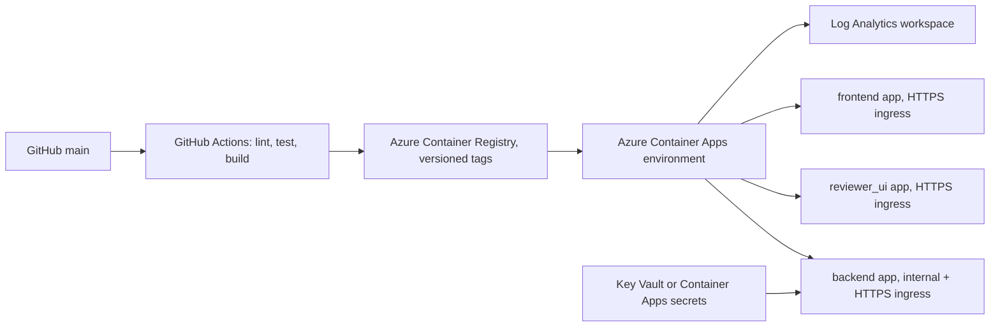

# Deployment: Docker and Azure

Owner: **Member 5** (architect wrote this first version). Status: **strategy only.**
No Dockerfile, Compose file or Azure resource exists yet. Final Dockerfiles wait until
the real entry points exist: `backend/app/main.py` (Member 1), and `reviewer_ui/app.py`
plus `frontend/` (Member 4). Nothing has been deployed.

## 1. Local containers

Target command: `docker compose up --build`

| Service | Source | Image strategy | Container port | Host port | Health check |
|---|---|---|---|---|---|
| `backend` | `backend/`, `policy_engine/`, `ai_engine/`, `contracts/`, `data/` | Multi-stage `python:3.13-slim`: the builder stage installs wheels, the runtime stage copies them. Runs as a non-root user (`appuser`). | 8000 | 8000 | `GET /api/health` |
| `reviewer_ui` | `reviewer_ui/`, `contracts/` | `python:3.13-slim`, non-root, `streamlit run reviewer_ui/app.py` | 8501 | 8501 | `GET /_stcore/health` |
| `frontend` | `frontend/` | Stage 1 `node:22-alpine` runs `npm ci && npm run build`. Stage 2 `nginxinc/nginx-unprivileged` serves `dist/` on 8080, non-root. | 8080 | 5173 | `GET /` |

Rules:
- **Env at runtime only.** Compose uses `env_file: .env` locally. Images never contain
  `.env`; `.dockerignore` excludes it.
- **Persistence.** A named volume `app-data` is mounted at `/app/outputs` for the SQLite
  database (`DATABASE_URL=sqlite:///outputs/app.db`), the mock outbox and audit exports.
- **Startup order.** `reviewer_ui` and `frontend` use `depends_on: backend` with
  `condition: service_healthy`.
- **Reproducible builds.** Pin base image tags, build from requirements files, and add a
  lock step (e.g. `pip freeze` into `infrastructure/docker/constraints.txt`).
- **Image location.** Dockerfiles live in `infrastructure/docker/`
  (`backend.Dockerfile`, `reviewer-ui.Dockerfile`, `frontend.Dockerfile`).
  `docker-compose.yml` lives at the repo root (Member 5).
- **Offline demo.** `LLM_PROVIDER=mock` runs the full flow without an API key.
- **Docker Desktop must be running.** On the lead's machine the CLI (28.1.1) and Compose
  (v2.35.1) are installed, but the engine was not confirmed running during setup.

Troubleshooting checklist (to be filled by Member 5 after the first rehearsal): port
conflicts, volume permissions for the non-root user, CORS origins, health check timing.

## 2. Azure plan (not executed)

**Preferred:** Azure Container Apps. **Alternative:** Azure App Service for Containers.

| Concern | Plan |
|---|---|
| Registry | Azure Container Registry. Image tags are the git SHA (immutable); no `latest` in deploys. |
| Pulling images | A user-assigned managed identity with `AcrPull`. No registry passwords. |
| Secrets | `ANTHROPIC_API_KEY` and `GROQ_API_KEY` as Container Apps secrets, or Key Vault references through the managed identity. Never in the repo, images or workflow logs. |
| HTTPS | Container Apps managed ingress with TLS. The backend can be internal-only if both UIs proxy to it. |
| Health | Liveness and readiness probes on `/api/health` (backend) and `/_stcore/health` (Streamlit). |
| Logs | Container Apps environment linked to Log Analytics. Logs never contain email addresses or prompt bodies with customer data. |
| Persistence | SQLite on Azure Files is acceptable only for the demo. For anything shared, use Azure Database for PostgreSQL (the data layer is PostgreSQL-compatible). |
| Scale | Min replicas 1 for the demo, max 1 for the backend while on SQLite. |

### GitHub Actions deploy outline (`.github/workflows/deploy.yml`, Member 5, later)
1. Trigger: `workflow_dispatch` only (manual, approved), on `main`.
2. `permissions: id-token: write, contents: read`.
3. `azure/login` with **OIDC federated credentials**. The repository secrets hold only
   `AZURE_CLIENT_ID`, `AZURE_TENANT_ID` and `AZURE_SUBSCRIPTION_ID`; there are no client secrets.
4. Run tests (this must pass), then `az acr build` (or docker build and push) tagged with `${{ github.sha }}`.
5. `az containerapp update --image <acr>/<service>:<sha>` for each service.
6. Smoke test: `curl https://<backend-fqdn>/api/health`.
7. Use a GitHub `environment` with required reviewers as the human approval gate.

Azure Pipelines YAML is prepared only if the team chooses Azure DevOps as the source host.

### Prerequisites and approvals
- Azure CLI is **not installed** on the lead's machine: `winget install -e --id Microsoft.AzureCLI`.
- Confirm subscription access, the resource provider registrations
  (`Microsoft.App`, `Microsoft.ContainerRegistry`, `Microsoft.OperationalInsights`),
  quotas and expected cost before the event.
- **Do not create any resource group, registry or app, or deploy, without explicit
  team approval.** These are billable and public-facing actions.
