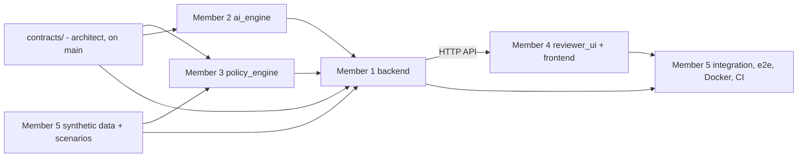

# Team Assignments and Ownership

Five members plus the architect (team lead, main Claude Code session). Full per-member
specifications are in `docs/members/`. This file is the single source of truth for
**who owns which path**. If a path is not listed for you, you do not edit it.

## Ownership matrix

| Path | Owner | Notes |
|---|---|---|
| `CLAUDE.md`, `README.md`, `NOTES.md` | Architect | |
| `contracts/` | Architect | Canonical models, enums, module `Protocol`s. Change by approved PR only. |
| `docs/` (except rows below) | Architect | Requirements, architecture, contracts, guides |
| `docs/API_CONTRACTS.md`, `docs/DATA_DICTIONARY.md` | Architect | Frozen once the baseline merges |
| `pyproject.toml`, `requirements.txt`, `requirements-dev.txt` | Architect | Root `requirements.txt` only includes module files |
| `.env.example`, `.gitignore`, `Makefile` | Architect | Members request new env names via PR description |
| `.claude/` | Architect | Rules, agents, skills, hooks, commands |
| `.github/PULL_REQUEST_TEMPLATE/`, `.github/ISSUE_TEMPLATE/` | Architect | |
| `backend/` | **Member 1** Backend | Includes `backend/requirements.txt` |
| `ai_engine/` | **Member 2** AI/LLM | Includes `ai_engine/requirements.txt` and prompt templates |
| `policy_engine/` | **Member 3** Policy | Includes validators (`policy_engine/compliance/`) |
| `data/policies/`, `data/campaigns/` | **Member 3** Policy | Policy YAML is read by Member 3's loader |
| `frontend/` | **Member 4** Frontend | React + TypeScript (created by Member 4 with Vite) |
| `reviewer_ui/` | **Member 4** Frontend | Streamlit reviewer app (PS deliverable #1) |
| `data/synthetic/`, `data/fixtures/` | **Member 5** DevOps/QA | Customer CSV, labelled scenarios |
| `tests/` (root: integration, e2e, evaluation) | **Member 5** DevOps/QA | Module unit tests live inside each module |
| `infrastructure/`, `scripts/`, `docker-compose.yml`, `.dockerignore` | **Member 5** DevOps/QA | |
| `.github/workflows/` | **Member 5** DevOps/QA | Baseline `ci.yml` is created by the architect, then handed over |
| `docs/TESTING_STRATEGY.md`, `docs/DEPLOYMENT.md`, `docs/DEMO_SCRIPT.md`, `docs/EVALUATION_REPORT.md` | **Member 5** DevOps/QA | Architect writes the first version |

Requesting a change outside your paths: open an issue (template "Contract or ownership
change"), say what and why, and wait for architect approval. Do not edit, then ask.

## Members

| # | Role | Branch | Worktree | Spec |
|---|---|---|---|---|
| 1 | Backend engineer | `feature/backend` | `../team-backend` | `docs/members/MEMBER_1_BACKEND.md` |
| 2 | AI / LLM engineer | `feature/ai-engine` | `../team-ai` | `docs/members/MEMBER_2_AI.md` |
| 3 | Policy / decision engineer | `feature/policy-engine` | `../team-policy` | `docs/members/MEMBER_3_POLICY.md` |
| 4 | Frontend engineer | `feature/frontend` | `../team-frontend` | `docs/members/MEMBER_4_FRONTEND.md` |
| 5 | DevOps / QA / data engineer | `feature/devops-testing` | `../team-devops` | `docs/members/MEMBER_5_DEVOPS_QA.md` |

Names are placeholders: fill in `Name:` at the top of each member file.

## Who provides and consumes what

| Interface | Provider | Consumers |
|---|---|---|
| `contracts.models`, `contracts.enums` | Architect | Everyone |
| `PolicyEngine.classify / decide / validate` (`contracts/interfaces.py`) | Member 3 | Member 1 |
| `DraftGenerator.generate` (`contracts/interfaces.py`) | Member 2 | Member 1 |
| HTTP API (`docs/API_CONTRACTS.md`) | Member 1 | Member 4, Member 5 |
| Customer CSV and labelled scenarios (`data/synthetic`, `data/fixtures`) | Member 5 | Members 1, 3, evaluation |
| Policy YAML (`data/policies`) | Member 3 | Member 3's loader only (others go through `PolicyEngine`) |

## Dependency graph and order

Nobody waits to start: every member codes against `contracts/` and fakes.

- Member 1 uses fake `PolicyEngine` and `DraftGenerator` objects until 2 and 3 merge.
- Member 4 uses mocked API responses built from `docs/API_CONTRACTS.md` examples.
- Member 2 and Member 3 use hand-built `VerifiedFacts` and `CustomerProfile` objects.

**Merge order:** backend foundation, then policy, then AI, then frontend, then
DevOps/QA, then final integration. See `docs/INTEGRATION_GUIDE.md`.

**Do first:** Member 5's customer CSV and `scenarios.jsonl` (day 1, morning), because
Members 1 and 3 test against them. Member 1's `/api/health` and app skeleton.

## Commit convention

Conventional Commits with the module as scope, for example:
`feat(policy): add reminder stage selection`, `test(ai): cover malformed JSON retry`,
`fix(backend): block approve when validation failed`, `docs(contracts): add OfferCheck`.
Types: `feat`, `fix`, `test`, `docs`, `refactor`, `chore`, `ci`, `build`.

## Shared definition of done

1. Only owned paths changed (check `git diff --name-only main...HEAD`).
2. Module tests pass locally, and `ruff check` is clean. No test calls a real LLM API.
3. No secrets, `.env` files, email addresses or real personal data committed.
4. Contracts used, not redefined. Any contract need raised as an issue.
5. Completion report posted in the PR (template in each member file).
6. Known limitations written down honestly, including what was not tested.
